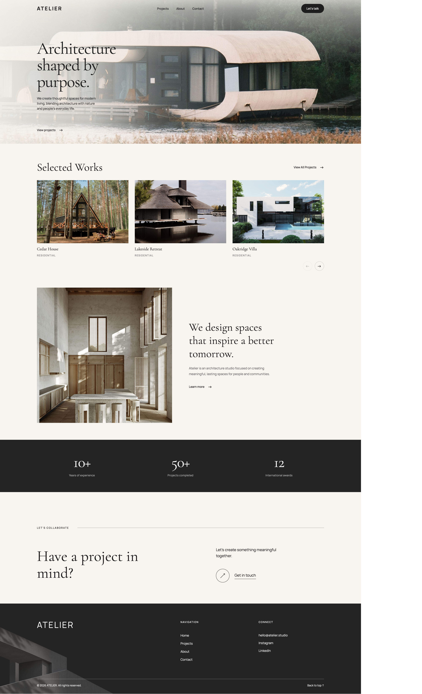
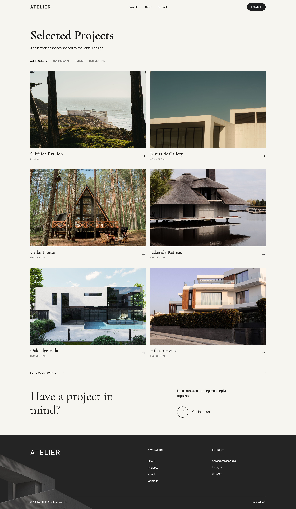
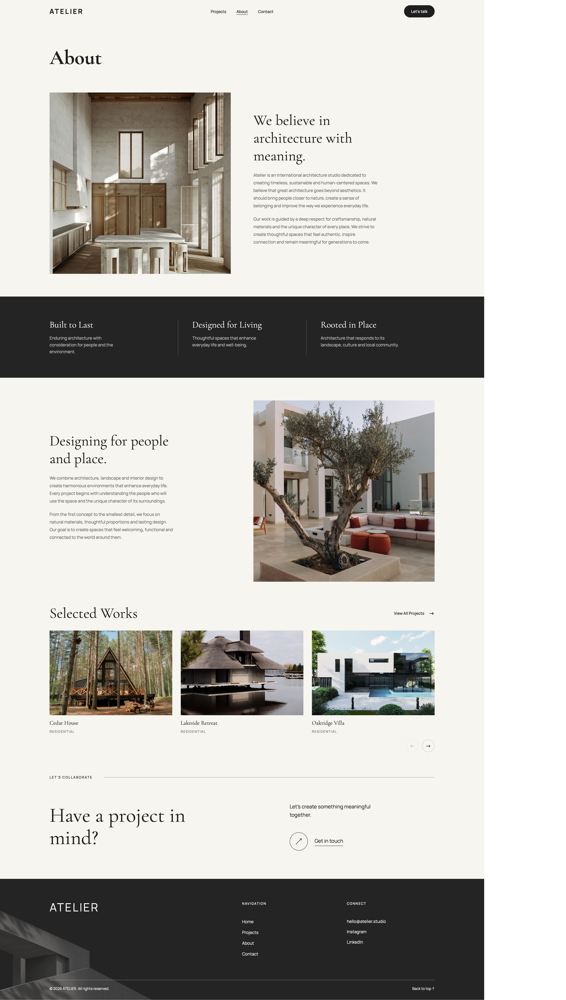
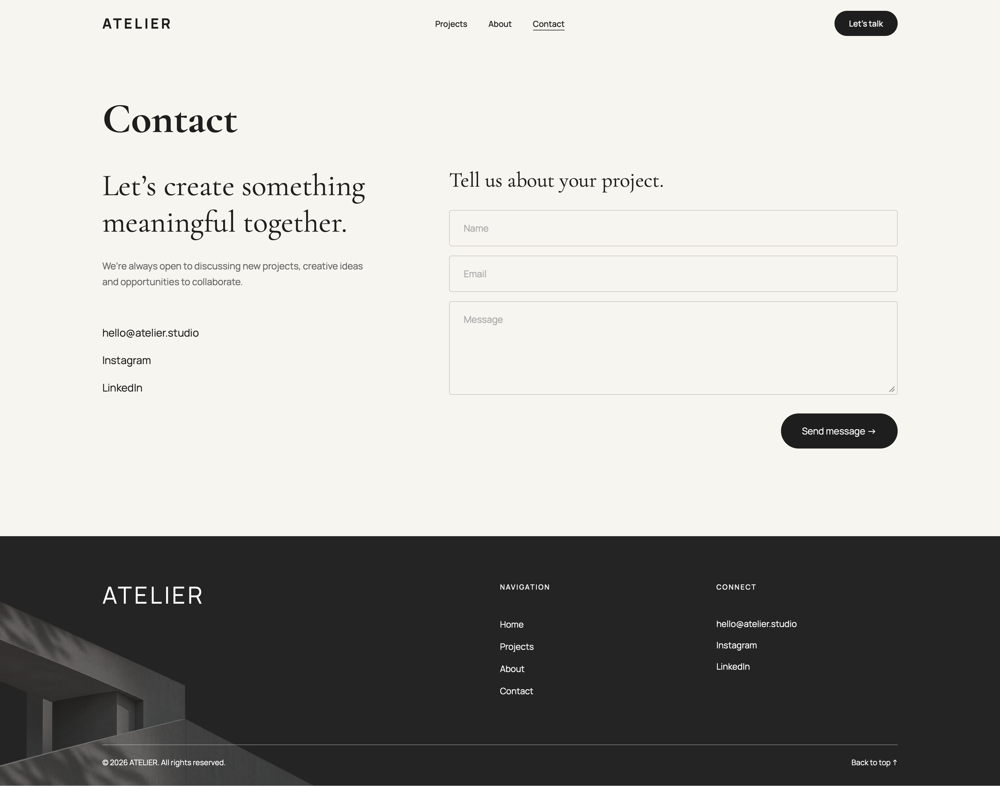
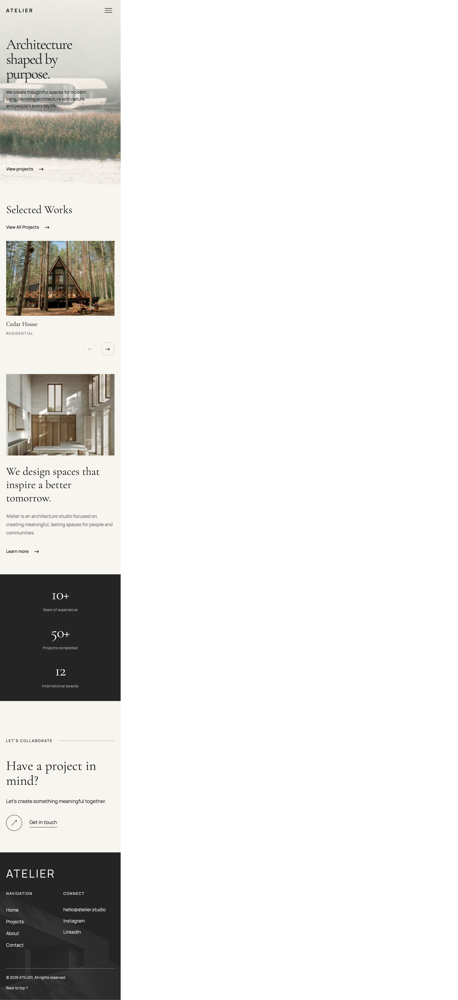

# ATELIER - Custom WordPress Website

ATELIER is a custom WordPress website developed for a fictional architecture studio. The project demonstrates custom theme development, dynamic content management and responsive frontend implementation.

The website was built from scratch using PHP, JavaScript and CSS without a page builder.

## Screenshots

### Homepage

### Projects

### About

### Contact

### Mobile Version

## Features

• Fully custom WordPress theme  
• Custom plugin for project management  
• Custom Post Type for architecture projects  
• Project categories using custom taxonomies  
• Advanced Custom Fields (ACF) integration  
• Dynamic project archive with AJAX filtering  
• Selected Works slider using Swiper.js  
• Individual project pages with project navigation  
• Editable Home, About and Contact pages  
• Contact Form 7 integration  
• Custom 404 page  
• Responsive layouts  
• Reusable PHP template parts  

## Tech Stack

• WordPress  
• PHP  
• HTML5  
• CSS3  
• JavaScript  
• Advanced Custom Fields (ACF)  
• Contact Form 7  
• Swiper.js  
• WordPress REST API  
• Git  

## Project Structure

### themes/atelier/

A custom WordPress theme responsible for the website layout, frontend functionality and reusable components.

### plugins/atelier-core/

A custom plugin responsible for registering project-related content types and taxonomies.

## Pages

• **Home:** Hero section, selected projects, studio introduction and statistics.  
• **Projects:** Dynamic project listing with category filtering.  
• **Single Project:** Individual project details, image gallery and navigation between projects.  
• **About:** Studio introduction, core values, design approach and selected works.  
• **Contact:** Contact information and inquiry form.  
• **404:** Custom page-not-found template.  

## About This Project

ATELIER is a portfolio demonstration project created to showcase WordPress development skills, including custom PHP templates, reusable components, ACF-powered content and frontend interactions.

The architecture studio and its content are fictional.
